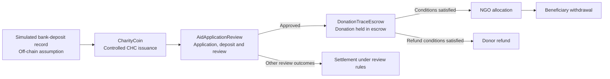

# CharityTrace

A locally tested smart-contract prototype for traceable charitable funding.

CharityTrace explores how rules for controlled token issuance, aid-application review, and donation escrow can be represented and tested on a blockchain. It is a **research and engineering prototype**, not a deployed charity platform or a real banking integration.

## Project flow



The diagram summarizes the intended workflow. The exact permissions and conditions are defined by the contracts and exercised by the tests; it does not imply that every step has been verified in a real-world charitable operation.

## Core components

| Component | Responsibility |
| --- | --- |
| `contracts/CharityCoin.sol` | Models controlled issuance and restrictions on ordinary token transfers. |
| `contracts/AidApplicationReview.sol` | Manages aid applications, review participation, deposits, and settlement rules. |
| `contracts/DonationTraceEscrow.sol` | Manages donation custody, allocation, withdrawal, and conditional refunds. |
| `contracts/LocalReviewRandomness.sol` | Supplies randomness for local review tests; not intended as production-grade randomness. |

The repository also contains `CharityVault.sol` and related tests. They are retained as part of the project's development and testing work; the end-to-end flow described above focuses on `CharityCoin`, `AidApplicationReview`, and `DonationTraceEscrow`.

## Run locally

**Requirements:** Node.js and npm. This project uses Hardhat 3, TypeScript, Mocha, and ethers v6.

From the repository root:

```powershell
npm ci
npx.cmd --no-install hardhat test --network hardhatMainnet
```

On systems where `npx` is directly available, use `npx --no-install hardhat test --network hardhatMainnet` instead.

The root `package.json` currently contains a placeholder `npm test` script. Use the Hardhat command above to run the test suite.

## What the tests demonstrate

The tests cover contract-level behavior and an integrated local scenario in `test/CharityCoinIntegration.ts`. The integrated scenario exercises controlled token issuance, application review, donation escrow, allocation and withdrawal, and a conditional refund path. Other tests examine selected authorization rules and failure cases.

**Local test result:** 54 tests passed locally (6 Solidity and 48 Mocha) using `hardhatMainnet`. This total includes five Hardhat template Counter tests (three Solidity and two Mocha); the remaining 49 tests cover project-specific behavior. The total should not be interpreted as 54 project-specific tests.

A passing local test suite shows that the implemented rules behave as expected in the tested scenarios. It does **not** establish that the contracts are secure for production use or that off-chain events are genuine.

## Security and Trust Model

CharityTrace records and enforces rules within a local smart-contract prototype. Its on-chain behavior should not be confused with independent verification of real-world charitable activities.

### Cryptography, encryption, and consensus

CharityTrace runs its tests on a local Ethereum-compatible Hardhat network. It relies on the network's account, transaction, and cryptographic mechanisms; the project does not implement a new encryption or consensus protocol.

| Technology | Role in this context | Does it keep data confidential? |
| --- | --- | --- |
| secp256k1 public-key cryptography | An externally owned account (EOA) uses its private key to sign transactions so that transaction authorization can be checked. | **No.** It is used here for digital signatures, not to encrypt application data. |
| Keccak-256 hashing | Used by Ethereum-compatible mechanisms, including address derivation and transaction identification. | **No.** Hashing is not data encryption. |
| Data encryption | Could protect sensitive documents, such as identity or medical records, in a future system. | **Not implemented or claimed by this prototype.** Signatures and hashes do not substitute for document encryption. |

- **Private keys, public keys, and addresses:** An EOA has a private key from which a public key can be derived using elliptic-curve cryptography. Ethereum EOAs use the secp256k1 curve. An EOA address is derived from its public key; it identifies an account, not a verified person. A private key must remain secret because someone who obtains it may be able to authorize transactions from that account.
- **Digital signatures:** A wallet signs an EOA transaction using the private key without publishing the private key. Ethereum's transaction-signature mechanism lets the network identify the signing account and check transaction authorization. A contract can then apply its own permission rules to the caller address. A valid signature does not prove the signer's real-world identity, show that the key was not stolen, or establish that an off-chain claim is true. Smart-contract accounts may use other authorization mechanisms; this private-key explanation concerns EOAs.
- **Signing and hashing are not encryption:** Signing verifies authorization, while hashing can help identify data or detect changes. Neither makes public transaction inputs or on-chain records confidential. CharityTrace does not claim to encrypt donation records, applications, or medical information. Sensitive identity and medical documents should not be placed directly on a public blockchain.
- **Document hashes and their limits:** In a future system, comparing a supplied document with a previously recorded hash could help detect changes. This repository does not claim to register or verify medical-document hashes. Even a matching hash would not prove that the original document was genuine or that its contents were true.
- **Network consensus:** Proof of Work (PoW) and Proof of Stake (PoS) are mechanisms by which blockchain networks can agree on transaction history. They are distinct from signatures, hashing, and contract-level permissions. CharityTrace does not implement its own PoW or PoS mechanism. Local Hardhat tests check selected contract behaviors, not the consensus security of a live public network.

### Future concept: a charitable community

A possible future direction is a charitable community in which participants complete volunteer work, receive a reward after their contribution has been verified, and can use that reward to support further charitable activities. This could create a cycle in which contributions help generate resources for new contributions. It is a proposed contribution-reward model, **not a feature implemented or tested in the current prototype**.

This idea may be described as inspired by "proof of work" in an informal sense, but it is **not blockchain PoW consensus**: volunteer time is not computational work used to validate blocks. Uploading a claim or document would not, by itself, prove that the work occurred. A future design would need an off-chain verification process, such as attestations from authorized organizations, before issuing rewards. It would also need safeguards against fabricated or duplicate claims, collusion, and multiple-identity abuse, while protecting volunteers' personal information.

The current contracts' token-issuance and transfer restrictions should not be assumed to support this reward-and-reinvestment cycle without further design and testing. Any real implementation would also require review of token economics, governance, legal obligations, and the security of verification and key management.

### What the prototype can and cannot establish

- **Authorization:** Contract permissions can restrict which accounts perform particular actions. A blockchain address alone does not prove the real-world identity or independence of its controller.
- **Recorded actions:** Contract records can help inspect actions performed within the prototype. They cannot independently prove that an applicant is eligible or that funds were used as claimed.
- **Conditional transfers:** Escrow can enforce conditions implemented in the contract. It cannot prove that a bank deposit occurred or that a beneficiary received a real-world payment.

### Off-chain trust boundaries

Bank-deposit records in the current workflow are simulated; this repository does not connect to a bank or verify fiat transactions. In a real-world system, medical documents, beneficiary eligibility, and the final use of funds would require separate off-chain verification.

Sensitive identity and medical documents should not be published on a public blockchain. If document hashes are introduced in future work, they could help detect whether a document has changed relative to a previously registered version, but they would not establish that the original document was genuine.

### Verification status

The local tests cover selected contract behaviors, authorization rules, and failure cases. They are not a production security audit or verification of real donations, bank payments, or medical documents. Any real deployment would require further review of access controls, privacy, key management, off-chain verification, bank-record reconciliation, and production-grade randomness.

## Scope and limitations

- **Local wallet-based interactions:** Contract interactions are exercised through test accounts on a local Hardhat network. These accounts simulate the roles of participants and authorize on-chain transactions; they do not represent verified real-world users or a production wallet infrastructure.
- **Simulated fiat activity:** Bank-deposit records are modeled as off-chain assumptions. The prototype does not connect to a bank, process fiat payments, or independently verify that a real deposit occurred.
- **Identity and participant independence:** A blockchain address identifies an account, not a verified individual or organization. Separate addresses do not, by themselves, establish that participants are independent.
- **Limits of on-chain traceability:** On-chain records can show contract interactions and the movement of tokens within the prototype. They cannot independently establish how funds or resources were used in the physical world.
- **Test-only randomness:** The local randomness provider supports testing and is not intended for production deployment.
- **Production readiness:** Administrative permissions, wallet and key management, operational controls, privacy, compliance, off-chain verification, and smart-contract security would all require further design and review before a real deployment.


## Contribution

The blockchain smart-contract implementation and testing were independently completed by Zhou Yinting.

## Status

Local prototype. No claim is made that this repository operates a live charitable service or handles real donations.