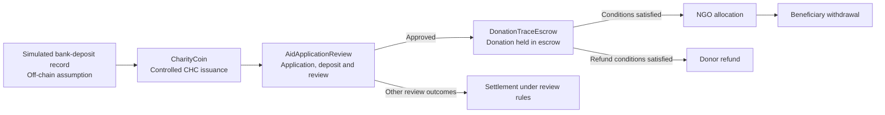

# CharityTrace

A locally tested smart-contract prototype for traceable charitable funding.

CharityTrace explores how rules for controlled token issuance, aid-application review, and donation escrow can be represented and tested on a blockchain. It is a **research and engineering prototype**, not a deployed charity platform or a real banking integration.

## Project flow



The diagram summarizes the intended workflow. The exact permissions and conditions are defined by the contracts and exercised by the tests; it does not imply that every step has been verified in a real-world charitable operation.

## Core components

| Component | Responsibility |
| --- | --- |
| `contracts/CharityCoin.sol` | Models controlled issuance and restrictions on ordinary token transfers. |
| `contracts/AidApplicationReview.sol` | Manages aid applications, review participation, deposits, and settlement rules. |
| `contracts/DonationTraceEscrow.sol` | Manages donation custody, allocation, withdrawal, and conditional refunds. |
| `contracts/LocalReviewRandomness.sol` | Supplies randomness for local review tests; not intended as production-grade randomness. |

The repository also contains `CharityVault.sol` and related tests. They are retained as part of the project's development and testing work; the end-to-end flow described above focuses on `CharityCoin`, `AidApplicationReview`, and `DonationTraceEscrow`.

## Run locally

**Requirements:** Node.js and npm. This project uses Hardhat 3, TypeScript, Mocha, and ethers v6.

From the repository root:

```powershell
npm ci
npx.cmd --no-install hardhat test --network hardhatMainnet
```

On systems where `npx` is directly available, use `npx --no-install hardhat test --network hardhatMainnet` instead.

The root `package.json` currently contains a placeholder `npm test` script. Use the Hardhat command above to run the test suite.

## What the tests demonstrate
This total includes five Hardhat template Counter tests (three Solidity and two Mocha); the remaining 49 tests cover project-specific behavior.
The tests cover contract-level behavior and an integrated local scenario in `test/CharityCoinIntegration.ts`. The integrated scenario exercises controlled token issuance, application review, donation escrow, allocation and withdrawal, and a conditional refund path. Other tests examine selected authorization rules and failure cases.

**Local test result:** 54 tests passed locally (6 Solidity and 48 Mocha) using `hardhatMainnet`.
The total includes tests for the Hardhat template Counter contract and should not be interpreted as 54 project-specific tests.
A passing local test suite shows that the implemented rules behave as expected in the tested scenarios. It does **not** establish that the contracts are secure for production use or that off-chain events are genuine.

## Scope and limitations

- Bank deposits are **simulated**; the project does not connect to a bank or verify real fiat deposits.
- Blockchain addresses do not, by themselves, establish real-world identity or independence between participants.
- On-chain records can show contract actions but cannot independently prove that funds were used as claimed in the physical world.
- The local randomness provider is for testing, not production deployment.
- Administrative permissions, operational controls, compliance requirements, and smart-contract security would require further review before any real deployment.

## Contribution

The blockchain smart-contract implementation and testing were independently completed by Zhou Yinting.

## Status

Local prototype. No claim is made that this repository operates a live charitable service or handles real donations.
