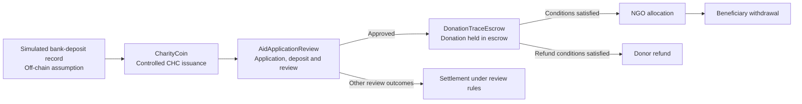

# CharityTrace

A locally tested smart-contract prototype for traceable charitable funding.

CharityTrace explores how rules for controlled token issuance, aid-application review, and donation escrow can be represented and tested on a blockchain. It is a **research and engineering prototype**, not a deployed charity platform or a real banking integration.

## Project flow



The diagram summarizes the intended workflow. The exact permissions and conditions are defined by the contracts and exercised by the tests; it does not imply that every step has been verified in a real-world charitable operation.

## Core components

| Component | Responsibility |
| --- | --- |
| `contracts/CharityCoin.sol` | Models controlled issuance and restrictions on ordinary token transfers. |
| `contracts/AidApplicationReview.sol` | Manages aid applications, review participation, deposits, and settlement rules. |
| `contracts/DonationTraceEscrow.sol` | Manages donation custody, allocation, withdrawal, and conditional refunds. |
| `contracts/LocalReviewRandomness.sol` | Supplies randomness for local review tests; not intended as production-grade randomness. |

The repository also contains `CharityVault.sol` and related tests. They are retained as part of the project's development and testing work; the end-to-end flow described above focuses on `CharityCoin`, `AidApplicationReview`, and `DonationTraceEscrow`.

## Run locally

**Requirements:** Node.js and npm. This project uses Hardhat 3, TypeScript, Mocha, and ethers v6.

From the repository root:

```powershell
npm ci
npx.cmd --no-install hardhat test --network hardhatMainnet
```

On systems where `npx` is directly available, use `npx --no-install hardhat test --network hardhatMainnet` instead.

The root `package.json` currently contains a placeholder `npm test` script. Use the Hardhat command above to run the test suite.

## What the tests demonstrate

The tests cover contract-level behavior and an integrated local scenario in `test/CharityCoinIntegration.ts`. The integrated scenario exercises controlled token issuance, application review, donation escrow, allocation and withdrawal, and a conditional refund path. Other tests examine selected authorization rules and failure cases.

**Local test result:** 54 tests passed locally (6 Solidity and 48 Mocha) using `hardhatMainnet`. This total includes five Hardhat template Counter tests (three Solidity and two Mocha); the remaining 49 tests cover project-specific behavior. The total should not be interpreted as 54 project-specific tests.

A passing local test suite shows that the implemented rules behave as expected in the tested scenarios. It does **not** establish that the contracts are secure for production use or that off-chain events are genuine.

## Security and Trust Model

CharityTrace records and enforces rules within a local smart-contract prototype. Its on-chain behavior should not be confused with independent verification of real-world charitable activities.

### Cryptography and consensus

The prototype runs on an Ethereum-compatible local test network. It relies on the network's underlying account and transaction mechanisms rather than implementing a new cryptographic protocol.

- **Public-key cryptography and signatures:** An externally owned account uses a private key to sign transactions. The corresponding public-key-based address identifies the account on the network, and the transaction signature allows the network to check that the transaction was authorized by the relevant key. This is a use of asymmetric cryptography for **authentication**, not encryption of donation or application data. A valid signature does not establish the signer's real-world identity or prove that the key has not been stolen. Smart-contract permission checks remain necessary.
- **Hashing and data integrity:** Cryptographic hashes are used by Ethereum-compatible blockchain mechanisms to identify and link transaction and block data. In principle, a recorded document hash could later help detect whether a supplied document has changed. CharityTrace does not currently claim to register or verify medical-document hashes. A matching hash would establish neither the document's authenticity nor the truth of its contents.
- **Privacy:** Digital signatures and hashes do not make publicly recorded information confidential. Sensitive identity or medical information should not be placed directly on a public blockchain. Any future system handling such records would need an appropriate off-chain storage, access-control, and encryption design; this repository does not claim to implement one.
- **Network consensus:** Proof of Work (PoW) and Proof of Stake (PoS) are mechanisms used by some blockchain networks to agree on transaction history. CharityTrace does not implement either mechanism. Its local Hardhat tests verify selected contract behaviors, not the consensus security of a live public network.

### Future concept: a charitable community

A possible future direction is a community in which participants contribute verified volunteer time, receive a charitable token as a reward, and can contribute that token to further charitable activities. This would be a **contribution-reward model inspired by the idea of proving work**, not blockchain PoW consensus or proof that work happened merely because a claim was uploaded.

Such a system would need a defined off-chain verification process: for example, an authorized organization could attest to a volunteer's activity, duration, and completion before any reward is issued. The contract could record the attestation and enforce reward rules, but it could not independently observe whether the volunteer work took place. Safeguards would be needed against fabricated records, duplicate claims, collusion, and rewards claimed through multiple identities, while protecting volunteers' personal information.

A separate future design might use token staking to encourage responsible behavior by reviewers or attesting organizations. Staking tokens alone would **not** make the project a PoS blockchain: PoS consensus concerns how a network validates blocks. Both the volunteer-reward and staking ideas are proposals for future research, not features implemented or tested in the current prototype. Token issuance and use would also require economic, legal, and operational review before any real deployment.

### What the prototype can and cannot establish

- **Authorization:** Contract permissions can restrict which accounts perform particular actions. A blockchain address alone does not prove the real-world identity or independence of its controller.
- **Recorded actions:** Contract records can help inspect actions performed within the prototype. They cannot independently prove that an applicant is eligible or that funds were used as claimed.
- **Conditional transfers:** Escrow can enforce conditions implemented in the contract. It cannot prove that a bank deposit occurred or that a beneficiary received a real-world payment.

### Off-chain trust boundaries

Bank-deposit records in the current workflow are simulated; this repository does not connect to a bank or verify fiat transactions. In a real-world system, medical documents, beneficiary eligibility, and the final use of funds would require separate off-chain verification.

Sensitive identity and medical documents should not be published on a public blockchain. If document hashes are introduced in future work, they could help detect whether a document has changed relative to a previously registered version, but they would not establish that the original document was genuine.

### Verification status

The local tests cover selected contract behaviors, authorization rules, and failure cases. They are not a production security audit or verification of real donations, bank payments, or medical documents. Any real deployment would require further review of access controls, privacy, key management, off-chain verification, bank-record reconciliation, and production-grade randomness.

## Scope and limitations

- Bank deposits are **simulated**; the project does not connect to a bank or verify real fiat deposits.
- Blockchain addresses do not, by themselves, establish real-world identity or independence between participants.
- On-chain records can show contract actions but cannot independently prove that funds were used as claimed in the physical world.
- The local randomness provider is for testing, not production deployment.
- Administrative permissions, operational controls, compliance requirements, and smart-contract security would require further review before any real deployment.

## Contribution

The blockchain smart-contract implementation and testing were independently completed by Zhou Yinting.

## Status

Local prototype. No claim is made that this repository operates a live charitable service or handles real donations.